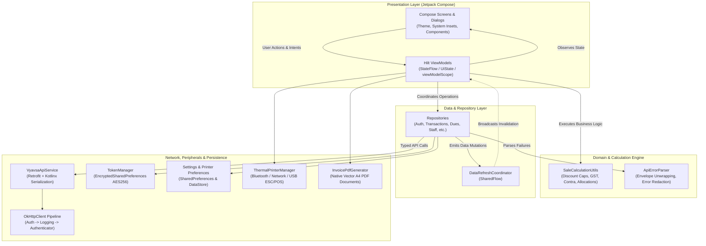
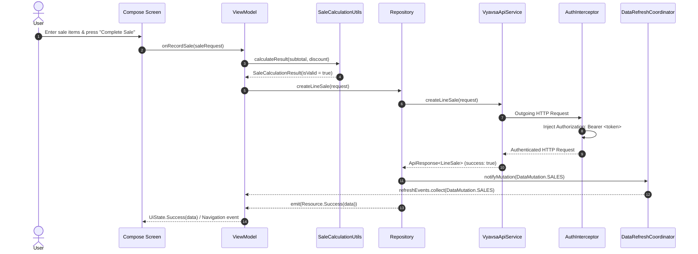
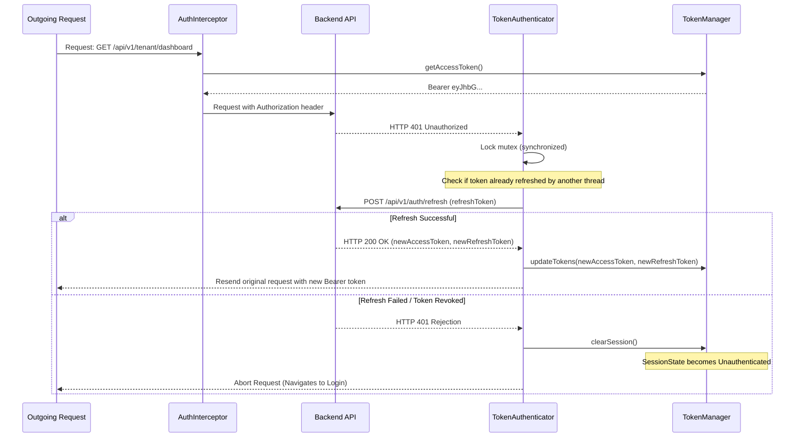

# Vyavsa Mobile — Native Android Business Management Application

[](https://kotlinlang.org)
[](https://developer.android.com/studio/releases/gradle-plugin)
[](https://developer.android.com/about/versions/14)
[](https://developer.android.com/about/versions/oreo)
[](https://developer.android.com/jetpack/compose)
[](https://dagger.dev/hilt/)

Vyavsa is an enterprise-grade native Android business management application engineered for Indian Micro, Small, and Medium Enterprises (MSMEs), retail shop owners, and distribution businesses. The application provides unified, end-to-end management of retail and distribution sales, credit ledgers (*Khata*), multi-party accounting, supplier payables, inventory cataloging, expense tracking with multi-bank split allocations, staff attendance and payroll, hardware-accelerated ESC/POS thermal receipt printing, and high-resolution PDF invoice generation.

---

## Table of Contents

1. [Project Overview](#1-project-overview)
2. [Key Features](#2-key-features)
3. [Technology Stack](#3-technology-stack)
4. [Application Architecture](#4-application-architecture)
5. [Project Directory Structure](#5-project-directory-structure)
6. [Architecture and Data Flow](#6-architecture-and-data-flow)
7. [Authentication and API Integration](#7-authentication-and-api-integration)
8. [State Management](#8-state-management)
9. [Local Data Persistence](#9-local-data-persistence)
10. [Navigation Structure](#10-navigation-structure)
11. [Build and Run Instructions](#11-build-and-run-instructions)
12. [Environment Configuration](#12-environment-configuration)
13. [Dependencies](#13-dependencies)
14. [Testing](#14-testing)
15. [Error Handling and Performance Considerations](#15-error-handling-and-performance-considerations)
16. [Development Guidelines](#16-development-guidelines)

---

## 1. Project Overview

Vyavsa is designed from the ground up to solve the real-world operational challenges of Indian retail and distribution businesses. Operating in environments that range from busy wholesale markets to modern retail storefronts, the application emphasizes high-speed data entry, zero-reflection serialization, strict monetary precision, multi-transport thermal printing, and dynamic multi-language localization.

The application acts as a native front-end client for the companion Go-powered Vyavsa Enterprise REST API. All state modifications, ledger balances, and role authorizations are authoritatively resolved on the server, while the Android client delivers responsive, offline-tolerant, and secure interactions through unidirectional data flow and reactive in-memory synchronization.

---

## 2. Key Features

### Authentication & User Sessions
- **Multi-Tenant Authentication**: Tenant registration and role-based login for administrative, office, and field staff.
- **Secure Password Reset**: Multi-step OTP verification flow (`forgot-password` &rarr; `verify-reset-otp` &rarr; `reset-password`).
- **Encrypted Token Management**: Hardware-backed credential persistence using AndroidX `EncryptedSharedPreferences` (`AES256_GCM`).
- **Concurrent-Safe Token Refresh**: Thread-safe mutex lock preventing stampeding token refreshes, with automatic retry termination (`responseCount >= 2`) and session purging upon authorization expiry.
- **Reactive Session Observation**: Global `StateFlow<SessionState>` driving authentication routing without Activity recreation.

### Role-Based Experience (RBAC)
- **Role Differentiation**: Tailored UI experiences and capabilities for `ADMIN`, `OFFICE`, `SALES`, and `USER` roles.
- **Dynamic Dock Navigation**: Context-aware bottom bar exposing role-specific primary workflows (e.g., Sales staff see line sales and catalog; Office staff see counter POS, cash drawer, and staff management).
- **Client-Side Action Guards**: Runtime capability checks (`TokenManager.canAccess...`) governing screen accessibility while server-side middleware enforces multi-tenant isolation.

### Role-Tailored Dashboards
- **Admin Dashboard**: Consolidated executive financial overview, gross revenue, net sales, line vs. counter graphs, aggregate customer dues, and cash/bank balances.
- **Sales Dashboard**: Daily sales targets, fast line-sale recording shortcut, catalog quick-search, and outstanding customer balance lookup.
- **Office Dashboard**: Real-time cash drawer reconciliation, bank settlement overview, quick counter billing, and staff attendance indicators.

### Sales Management (Line & Counter POS)
- **Line Sales (Distribution)**: Multi-item wholesale sales order management, custom rate overrides, percentage/flat discounts, multi-bracket GST tax computation (CGST + SGST), payment allocation (Cash, Bank, Split, Due), sales status tracking, and cancellation.
- **Counter Sales (Retail POS)**: High-speed counter checkout designed for retail operations, instant cash drawer integration, customer association, and automatic direct printing.
- **Financial Calculation Engine**: Authoritative `SaleCalculationUtils` performing non-negative discount validation, discount clamping (cannot exceed eligible subtotal), intra-state GST tax splitting, and `BigDecimal` rounding (`HALF_UP`).
- **POS Allocation & Automatic Contra Settlement**: Calculates customer advance offsets, settles previous credit dues from excess payments, generates advance credit balances, and adjusts dual-party supplier/customer contra balances.

### Expense Management
- **Category-Based Expense Logging**: Track operational business expenses across predefined categories (Rent, Utilities, Travel, Supplies, Maintenance, etc.).
- **Flexible 3-Mode Payment Allocations**:
  - `Cash Till`: Immediate deduction from the cash drawer.
  - `Bank Account(s)`: Settlement via one or more registered business bank accounts.
  - `Cash + Bank`: Split settlement combining physical cash and bank allocations.
- **Dynamic Multi-Bank Allocation Breakdown**: Add, remove, and configure dynamic `BankPaymentSplit` rows with individual amounts and bank accounts (`bank_account_id`).
- **Real-Time Allocation Guard**: Live breakdown card computing total expense, allocated amount, remaining balance, auto-balance quick action, duplicate bank selection prevention, and `BigDecimal` validation.

### Account Book & Khata (Parties, Dues & Ledgers)
- **Unified Business Parties**: Unified management of Customers, Suppliers, and Dual Parties (both customer and supplier) with detailed balance auditing.
- **Customer Dues & Advances**: Track individual customer credit balances, collect partial/full payments, record customer advance deposits, apply advances to outstanding invoices, and perform audited balance adjustments.
- **Supplier Payables**: Monitor supplier purchase balances and disburse payments directly via cash or bank accounts.
- **Statement Generation**: Complete transaction ledger statements with date-range filtering and downloadable native A4 PDF statements.
- **Direct Communication Shortcuts**: Integrated phone dialer and WhatsApp chat triggers via `DialerUtils`.

### Cash Drawer & Bank Account Management
- **Cash Drawer**: Opening float balance tracking, cash-in / cash-out records, real-time drawer balance, and manual adjustment auditing.
- **Bank Accounts**: Register multiple business accounts (Bank Name, Account Number, IFSC, Branch, Balance), audit individual bank statement ledgers, and manage transaction records.

### Staff & Human Resources
- **Employee Directory**: Track staff details, roles, base salaries, contact numbers, and employment dates.
- **Attendance Tracking**: Daily attendance logging (`PRESENT`, `ABSENT`, `HALF_DAY`, `LEAVE`) with overtime hours.
- **Advances & Overtime**: Log cash/bank advances deductible against payroll, and register overtime compensation.
- **Salary Processing**: Automated net salary computation taking into account attendance ratios, overtime additions, and advance deductions, with direct disbursement via cash or bank.
- **Salary Slips**: Downloadable and printable native PDF salary vouchers.

### Product Catalog & Inventory
- **Product Management**: SKU, barcode scanning, category assignment, purchase/retail pricing, unit definitions, and stock level tracking.
- **Product Analytics**: High-performing items, sales velocity, low-stock warnings, and revenue breakdown.

### Peripheral Hardware (Thermal Printing & Document Generation)
- **Hardware-Agnostic ESC/POS Engine**: Native ESC/POS command generation (`EscPosCommands`) supporting standard thermal printers without proprietary third-party vendor SDK bloat.
- **Multi-Transport Communication**:
  - `Bluetooth SPP`: Serial Port Profile communication using RFCOMM sockets.
  - `Network Socket`: Raw TCP socket streaming (port 9100) for Ethernet and Wi-Fi thermal printers.
  - `USB Host`: Android USB Host API bulk transfer communication for direct OTG-connected printers.
- **Configurable Invoice Templates**:
  - Formats: 58mm (strictly 32 columns) and 80mm (strictly 48 columns).
  - Visual Themes: `CLASSIC`, `MODERN`, `MINIMAL`, and `DETAILED`.
  - Configurable metadata toggles (address, phone, email, tax ID/GSTIN, customer info, notes, bank payment details, logo).
- **Standards-Compliant A4 PDF Generation**: Native `InvoicePdfGenerator` producing vector A4 invoices with company branding, table borders, itemized totals, tax summaries, and secure Android `FileProvider` sharing (`InvoiceShareManager`).

### Dashboard Quick Actions & Settings Customization
- **Dashboard Quick Actions**: 7 customizable quick action cards (`CREATE_LINE_SALE`, `CREATE_COUNTER_SALE`, `CREATE_EXPENSE`, `CREATE_PURCHASE`, `CASH_DRAWER`, `BANK_ACCOUNTS`, `PRODUCTS`) dynamically laid out in a responsive 2-column grid.
- **Defensive Preference Storage**: Persistent quick action toggling with corrupted set sanitization and defensive `HashSet` copy isolation.
- **Dock Customization**: User-reorderable bottom navigation destinations persisted in app settings.
- **Display & Typography Scaling**: Dynamic theme switching (`SYSTEM`, `LIGHT`, `DARK`) and accessibility font scaling (`SMALL` 90%, `MEDIUM` 100%, `LARGE` 115%).
- **In-App Localization (12 Languages)**: Per-app language switching supporting 11 Indian regional languages (Assamese, Bengali, Gujarati, Hindi, Kannada, Malayalam, Marathi, Odia, Punjabi, Tamil, Telugu) plus English, without requiring system OS language modification.

### Tenant Administration & Subscription Plans
- **Tenant Profile**: Manage business profile, tax registration, address, and upload/remove company logo with multipart image streaming.
- **Tenant User Management**: Administrative management of tenant operators, assigning roles, updating credentials, and deactivating user access.
- **Subscription Plans & Checkout**: Browse available subscription tiers, initiate checkout sessions, verify signatures, and view payment transaction history.

---

## 3. Technology Stack

| Layer / Concern | Technology | Version | Purpose & Rationale |
| :--- | :--- | :--- | :--- |
| **Language** | Kotlin | `1.9.24` | Strict nullability, coroutines, sealed types |
| **JVM Target** | Java 17 | `17` | Modern language features and compiler optimizations |
| **Android Gradle Plugin** | AGP | `8.13.2` | Gradle build orchestration and artifact packaging |
| **SDK Targets** | Android SDK | min: `26`, target: `34` | Android 8.0 Oreo up to Android 14 compatibility |
| **UI Framework** | Jetpack Compose | BOM `2024.04.01` | Declarative, reactive UI architecture |
| **Design System** | Material Design 3 | Compose M3 | Modern color tokens, dynamic theming, elevation |
| **Navigation** | Navigation Compose | `2.7.7` | Type-safe single-activity navigation graph |
| **Dependency Injection** | Dagger Hilt | `2.51.1` | Compile-time dependency injection with KSP |
| **Networking** | Retrofit & OkHttp | `2.11.0` / `4.12.0` | Type-safe REST client with interceptor pipeline |
| **Serialization** | Kotlinx Serialization | `1.6.3` | Reflection-free, compile-time JSON encoding |
| **Asynchrony** | Coroutines & Flow | `1.8.0` | Structured concurrency, reactive `StateFlow`/`SharedFlow` |
| **Secure Storage** | AndroidX Security Crypto | `1.1.0-alpha06` | Hardware-backed `EncryptedSharedPreferences` (AES-256) |
| **Preferences Storage** | Preferences DataStore / SharedPreferences | `1.1.1` | Settings, dock order, and printer configuration |
| **Document Generation** | Android Graphics & PDF | Native Android | High-fidelity vector PDF generation and printing |
| **Hardware Peripherals** | Android Bluetooth & USB | Native Android | RFCOMM Bluetooth SPP and USB Host printing |
| **Unit Testing** | JUnit 4, MockWebServer | `4.13.2` / `4.12.0` | Isolated unit testing and API contract verification |

---

## 4. Application Architecture

Vyavsa implements a modern **Model-View-ViewModel (MVVM)** architecture incorporating unidirectional data flow, clean layer boundaries, and in-memory event-driven synchronization.



### Architectural Layer Responsibilities

1. **Presentation Layer (`feature/*`, `navigation/*`, `core/designsystem/`)**:
   - Built entirely in Jetpack Compose using Material 3.
   - Screen composables consume immutable presentation state via `StateFlow` and delegate user events to their respective ViewModels.
   - Zero business or network code resides inside composables.
2. **ViewModel Layer (`feature/*ViewModel.kt`)**:
   - Manages UI state encapsulated in `UiState<T>` (`Idle`, `Loading`, `Success`, `Error`).
   - Executes non-blocking operations within `viewModelScope`.
   - Coordinates domain calculations (`SaleCalculationUtils`) before network dispatch.
   - Listens to `DataRefreshCoordinator` to automatically refresh stale data when mutative operations occur across different screens.
3. **Repository Layer (`core/di/RepositoryModule.kt`, `feature/*Repository.kt`)**:
   - Injected via Dagger Hilt interfaces (`@Binds` in `RepositoryModule`).
   - Translates raw API responses into typed domain resources (`Flow<Resource<T>>`).
   - Handles network failure mapping using `ApiErrorParser`.
4. **Network & Security Layer (`core/network/`, `core/security/`)**:
   - OkHttp pipeline with specialized interceptors (`AuthInterceptor`, `RedactedLoggingInterceptor`, `TokenAuthenticator`).
   - `TokenManager` backed by `EncryptedSharedPreferences` (`AES256_GCM`).
5. **Peripheral & Document Engine (`core/printer/`, `core/document/`)**:
   - Pluggable thermal printing transports implementing `ThermalPrinterManager`.
   - Native A4 PDF generation and `FileProvider` sharing.

---

## 5. Project Directory Structure

```text
vyavsa_mobile/
├── app/
│   ├── build.gradle.kts                   # Application Gradle build configuration & dependencies
│   ├── proguard-rules.pro                 # ProGuard obfuscation & R8 optimization rules
│   └── src/
│       ├── main/
│       │   ├── AndroidManifest.xml        # Application manifest, permissions & FileProvider
│       │   ├── java/com/vyavsa/app/
│       │   │   ├── MainActivity.kt        # Single activity, edge-to-edge, dynamic localization
│       │   │   ├── VyavsaApp.kt           # Application subclass, Hilt setup, crash logger
│       │   │   │
│       │   │   ├── core/                  # Shared infrastructure & foundational subsystems
│       │   │   │   ├── common/            # Utilities (FormatUtils, SaleCalculationUtils, LocaleHelper)
│       │   │   │   ├── designsystem/      # Material 3 Theme, Color palette, reusable Components
│       │   │   │   ├── di/                # Dagger Hilt Dependency Injection modules
│       │   │   │   ├── document/          # Native A4 PDF generation & FileProvider sharing
│       │   │   │   ├── model/             # Shared data models, API envelopes, DTOs
│       │   │   │   ├── navigation/        # Screen route registry & BottomBarDestination
│       │   │   │   ├── network/           # Retrofit service, interceptors, error parsers
│       │   │   │   ├── printer/           # ESC/POS commands, thermal formatters & transports
│       │   │   │   ├── security/          # TokenManager (EncryptedSharedPreferences), RBAC permissions
│       │   │   │   ├── settings/          # Persistent app preferences, quick actions, dock order
│       │   │   │   └── sync/              # DataRefreshCoordinator reactive event bus
│       │   │   │
│       │   │   ├── feature/               # Vertical feature modules (MVVM)
│       │   │   │   ├── auth/              # Login, Registration, OTP Password Reset
│       │   │   │   ├── bank/              # Bank accounts list, registration, transactions
│       │   │   │   ├── cash/              # Cash drawer management, float balance, entries
│       │   │   │   ├── dashboard/         # Role-tailored dashboards (Admin, Sales, Office)
│       │   │   │   ├── dues/              # Customer & supplier khata, ledgers, statements
│       │   │   │   ├── party/             # Unified business parties, detail auditing
│       │   │   │   ├── plans/             # Subscription tiers, checkout & payment verification
│       │   │   │   ├── products/          # Product catalog, stock tracking, sales analytics
│       │   │   │   ├── profile/           # Tenant profile, logo upload, business settings
│       │   │   │   ├── settings/          # App settings (Theme, Font, Languages, Printing, Dock)
│       │   │   │   ├── staff/             # Employee roster, daily attendance, payroll
│       │   │   │   ├── supplier/          # Supplier repository & balances
│       │   │   │   ├── transactions/      # Line sales, counter sales, purchases, expenses
│       │   │   │   └── users/             # Tenant user administration (Admin only)
│       │   │   │
│       │   │   └── navigation/            # Navigation host & Main shell container
│       │   │       ├── MainShellScreen.kt # Bottom navigation dock container & role switching
│       │   │       └── VyavsaNavGraph.kt  # Root NavHost, animated transitions & route definitions
│       │   │
│       │   └── res/                       # Android resources (drawables, layouts, strings, values-*)
│       │
│       └── test/java/com/vyavsa/app/      # Comprehensive JVM Unit Test Suite (47 test suites)
│           ├── core/                      # Tests for calculation utils, error parser, printer, security
│           ├── feature/                   # ViewModel, serialization contract, and repository tests
│           └── ApiResponseSerializationTest.kt
│
├── gradle/
│   ├── libs.versions.toml                 # Version catalog declaring dependencies and plugins
│   └── wrapper/                           # Gradle Wrapper (v8.13)
├── build.gradle.kts                       # Root build script
├── settings.gradle.kts                    # Repository definitions & plugin management
├── AGENTS.md                              # Antigravity agent operational guidelines
└── README.md                              # Architectural & developer documentation
```

---

## 6. Architecture and Data Flow

### 1. Typical Operation Lifecycle (UI to API)



### 2. Multi-Mode Expense Allocation Data Flow

```mermaid
flowchart LR
    A["User Inputs Expense Amount"] --> B{"Select Payment Mode"}
    B -->|Cash Till| C["Cash Drawer Allocation\n(cash_amount = Total)"]
    B -->|Bank Account(s)| D["Bank Payment Splits\n(bank_payments: [ {bank_id, amount} ])"]
    B -->|Cash + Bank Split| E["Hybrid Breakdown\n(cash_amount + sum(bank_splits) == Total)"]
    C --> F["TransactionsViewModel Validation\n(Total == Allocated, Positive Amounts)"]
    D --> F
    E --> F
    F -->|Validation Passed| G["POST /api/v1/expenses"]
    F -->|Validation Failed| H["UI Error: Remaining Balance Unallocated"]
    G --> I["DataRefreshCoordinator\n(DataMutation.EXPENSES, BANK, CASH)"]
```

---

## 7. Authentication and API Integration

### Token Lifecycle & Concurrency Control



- **AuthInterceptor**: Injects the Bearer token into outgoing requests. Automatically skips public endpoints (`login`, `register`, `forgot-password`, `verify-reset-otp`, `reset-password`, `refresh`).
- **TokenAuthenticator**: Intercepts `401 Unauthorized` responses. Uses a thread-safe mutex lock to avoid duplicate token refreshes when parallel network calls fail simultaneously. Enforces `responseCount >= 2` loop termination.
- **RedactedLoggingInterceptor**: Logs HTTP calls and timing while redacting `Authorization` and `Cookie` headers across all builds.
- **Unified API Response Envelope**: All API endpoints communicate through the typed `ApiResponse<T>` envelope:
  ```kotlin
  @Serializable
  data class ApiResponse<T>(
      val success: Boolean,
      val data: T? = null,
      val message: String? = null,
      val error: ApiErrorDetail? = null,
      val pagination: ApiPagination? = null
  )
  ```

---

## 8. State Management

The application implements strict unidirectional data flow using Kotlin Coroutines and StateFlow:

- **`UiState<T>`**: Represents asynchronous presentation states:
  ```kotlin
  sealed interface UiState<out T> {
      object Idle : UiState<Nothing>
      object Loading : UiState<Nothing>
      data class Success<out T>(val data: T) : UiState<T>
      data class Error(val message: String) : UiState<Nothing>
  }
  ```
- **`Resource<T>`**: Encapsulates repository results with error codes and field-level validation details:
  ```kotlin
  sealed class Resource<out T> {
      object Loading : Resource<Nothing>()
      data class Success<out T>(val data: T) : Resource<T>()
      data class Error(val message: String, val code: String? = null, val details: Map<String, String>? = null) : Resource<Nothing>()
  }
  ```
- **In-Memory Data Synchronization (`DataRefreshCoordinator`)**:
  - Eliminates stale data across screens without requiring full page remounts.
  - When mutations happen (e.g., `DataMutation.EXPENSES`, `SALES`, `CASH`, `BANK`), listening ViewModels automatically reload their corresponding datasets in the background.

---

## 9. Local Data Persistence

The application deliberately avoids a local relational database (e.g., Room) for transaction records:
- **Server as Authoritative Ledger**: The backend Go API represents the single source of truth. Maintaining an offline relational database for multi-user sales, inventory, and ledger calculations would introduce two-way conflict liabilities and complex synchronization anomalies.
- **Secure Credentials Storage**:
  - `TokenManager` uses AndroidX `EncryptedSharedPreferences` backed by `MasterKey` (`AES256_GCM`).
  - Access tokens, refresh tokens, and user profile information are safely persisted. An in-memory volatile cache eliminates main-thread cryptographic decryption overhead during Compose recomposition passes.
- **Application Preferences (`SettingsPreferences` & `PrinterPreferences`)**:
  - Manages UI preferences: Theme mode (`SYSTEM`, `LIGHT`, `DARK`), font scaling factor (`SMALL`, `MEDIUM`, `LARGE`), language choice, quick actions set, and bottom dock ordering.
  - Manages hardware printing preferences: Target device MAC/IP, connection transport type, paper width (58mm/80mm), and invoice layout theme.

---

## 10. Navigation Structure

The app uses a single-activity architecture (`MainActivity`) with a centralized navigation graph (`VyavsaNavGraph`).

### Root Navigation Hierarchy

- **Unauthenticated Flow**:
  - `Screen.Login` &rarr; `Screen.Register`
  - `Screen.ForgotPassword` &rarr; `Screen.VerifyOtp` &rarr; `Screen.ResetPassword`
- **Authenticated Shell (`Screen.MainShell`)**:
  - Bottom navigation dock hosting role-filtered destinations (`BottomBarDestination`):
    - `HOME` (Role-tailored Dashboard: Admin, Sales, or Office)
    - `SALES` (Line sales ledger)
    - `COUNTER_SALES` (Point of sale checkout)
    - `TRANSACTIONS` (Universal accounting ledger)
    - `DUES` (Customer & Supplier Khata)
    - `STAFF` (Attendance, Overtime, Salary roster)
    - `PRODUCTS` (Catalog & Analytics)
    - `MORE` (Profile, Tenant Settings, Subscriptions, Quick Actions)
- **Sub-Screens & Detail Destinations**:
  - `CreateLineSale`, `CreateCounterSale`, `CreateExpense`, `CreatePurchase`
  - `SaleDetails`, `PurchaseDetails`, `CustomerDetails`, `CustomerStatement`, `PartyDetails`
  - `CashDrawer`, `BankAccounts`, `Plans`, `TenantUsers`, `Settings`, `ProductAnalytics`

---

## 11. Build and Run Instructions

### Prerequisites
- **JDK**: Java Development Kit 17 (e.g., OpenJDK 17 or Android Studio Embedded JDK).
- **Android Studio**: Android Studio Hedgehog (2023.1.1) or newer (Iguana, Jellyfish, Koala, Ladybug).
- **Android SDK**: API Level 34 (Android 14) with Build-Tools `34.0.0`.

### Step-by-Step Setup

1. **Clone the Repository**:
   ```bash
   git clone <repository-url> vyavsa_mobile
   cd vyavsa_mobile
   ```

2. **Open in Android Studio**:
   - Open Android Studio &rarr; *File* &rarr; *Open...* &rarr; Select the `vyavsa_mobile` root directory.
   - Allow Gradle sync to complete and download all dependencies declared in `gradle/libs.versions.toml`.

3. **Build the Debug APK**:
   ```bash
   ./gradlew assembleDebug
   ```
   The compiled APK will be generated at:
   `app/build/outputs/apk/debug/app-debug.apk`

4. **Run Unit Tests**:
   ```bash
   ./gradlew testDebugUnitTest
   ```

5. **Run Lint Checks**:
   ```bash
   ./gradlew lintDebug
   ```

6. **Install onto Device or Emulator**:
   ```bash
   adb install -r app/build/outputs/apk/debug/app-debug.apk
   ```

---

## 12. Environment Configuration

### Base URL Resolution

The backend base URL is determined dynamically at build time and injected into `BuildConfig.BASE_URL`:

| Build Type | Default Value | Notes |
| :--- | :--- | :--- |
| **Debug** | `http://10.0.2.2:8080/` | Android emulator loopback alias to host machine localhost |
| **Release** | `https://vyavsa.varunjp.in/` | Production cloud deployment |

### Overriding the Base URL

For testing against a physical device on the local network or custom staging server:

1. **Via Gradle Property**:
   ```bash
   ./gradlew assembleDebug -Pvyavsa.baseUrl="http://192.168.1.50:8080/"
   ```
2. **Via Environment Variable**:
   ```bash
   export VYAVSA_BASE_URL="http://192.168.1.50:8080/"
   ./gradlew assembleDebug
   ```
3. **Release Target Base URL Override**:
   ```bash
   ./gradlew assembleRelease -Pvyavsa.prodBaseUrl="https://staging.vyavsa.varunjp.in/"
   ```

### Cleartext Traffic Policy
`app/src/main/res/xml/network_security_config.xml` enables cleartext HTTP traffic to facilitate local development with emulator loopback (`10.0.2.2`) and local LAN servers.

> [!CAUTION]
> **Zero Secrets Policy**: Never commit credentials, passwords, production API keys, or private certificates to source control.

---

## 13. Dependencies

All libraries and build plugins are cataloged in `gradle/libs.versions.toml`:

```toml
[versions]
agp = "8.13.2"
kotlin = "1.9.24"
ksp = "1.9.24-1.0.20"
hilt = "2.51.1"
composeBom = "2024.04.01"
composeCompiler = "1.5.14"
coreKtx = "1.13.1"
lifecycleRuntime = "2.7.0"
activityCompose = "1.9.0"
navigationCompose = "2.7.7"
hiltNavigationCompose = "1.2.0"
retrofit = "2.11.0"
okhttp = "4.12.0"
kotlinxSerialization = "1.6.3"
retrofitKotlinxSerialization = "1.0.0"
coroutines = "1.8.0"
datastore = "1.1.1"
securityCrypto = "1.1.0-alpha06"
materialIconsExtended = "1.6.6"
junit = "4.13.2"
androidxJunit = "1.1.5"
espresso = "3.5.1"
mockwebserver = "4.12.0"
```

---

## 14. Testing

The codebase includes an extensive suite of **47 automated unit test classes**, verifying business logic, financial algorithms, serialization schemas, and peripheral formatting.

### Test Coverage Categories

1. **Financial Precision & Invoicing Calculations**:
   - `SaleCalculationUtilsTest.kt`: Validates discount capping, non-negative inputs, intra-state GST tax math, and rounding behavior.
   - `ExpensePaymentAllocationTest.kt`: Validates expense allocations across Cash Till, single/multiple bank accounts, auto-balance calculations, and duplicate prevention.
   - `LineSaleBreakupAllocationTest.kt` & `AutomaticContraAdjustmentTest.kt`: Validates POS advance adjustments and supplier contra offsets.
2. **Serialization & API Contracts**:
   - `ApiResponseSerializationTest.kt`, `SalesSerializationTest.kt`, `PurchaseSerializationTest.kt`, `BankSerializationTest.kt`, `ProductSerializationTest.kt`, `PartySerializationTest.kt`, `ExpenseDateSerializationTest.kt`.
3. **Thermal Receipt Printing & Geometry**:
   - `ThermalInvoiceFormatterTest.kt` & `ThermalInvoiceFormatterThemesTest.kt`: Verifies strict character width constraints (32 characters for 58mm, 48 characters for 80mm) across all themes.
   - `NetworkPrinterManagerTest.kt`, `SaleDetailsViewModelPrinterTest.kt`, `TransactionsViewModelDirectPrintTest.kt`.
4. **Security, RBAC & Preferences**:
   - `PurchasesAndExpensesRbacTest.kt`: Validates role-based capability boundaries.
   - `QuickActionsPreferencesAndDashboardTest.kt`: Verifies dynamic grid persistence and corrupted preference sanitization.
   - `SettingsPreferencesTest.kt`, `DataRefreshCoordinatorTest.kt`.
5. **ViewModels & Screen Logic**:
   - `TransactionsViewModelTest.kt`, `DuesViewModelTest.kt`, `StaffViewModelTest.kt`, `BankViewModelTest.kt`, `ProductViewModelTest.kt`, `PlansViewModelTest.kt`, `ProfileViewModelTest.kt`, `RoleBasedDashboardTest.kt`.

### Running Tests

- Run all unit tests:
  ```bash
  ./gradlew testDebugUnitTest
  ```
- Run a targeted test suite:
  ```bash
  ./gradlew testDebugUnitTest --tests "com.vyavsa.app.feature.transactions.ExpensePaymentAllocationTest"
  ```

---

## 15. Error Handling and Performance Considerations

### Error Handling Strategy
- **Centralized Error Parsing (`ApiErrorParser`)**:
  - Automatically unwraps backend error envelopes: `{"success": false, "error": {"code": "...", "message": "...", "fields": {...}}}`.
  - Converts HTTP status codes (400, 401, 403, 404, 409, 422, 429, 500, 502, 503) into human-friendly messages.
  - Sanitizes log output by masking `Bearer` tokens and sensitive query parameters.
- **Fail-Safe UI Feedback**: ViewModels emit transient notification events via `OneTimeEventEmitter` and `UiMessage` to show Snackbars without breaking current navigation.

### Performance Optimizations
- **Compile-Time Code Generation**: Uses Kotlinx Serialization with KSP instead of runtime reflection libraries (Gson/Moshi), reducing APK size and CPU overhead.
- **Memory-Safe Preference Access**: In-memory caching inside `TokenManager` avoids repeated hardware keystore decryption on UI recomposition cycles.
- **Compose Stability**: Domain models use `@Immutable` annotations, ensuring Compose skips unnecessary recompositions.
- **Buffered Thermal Streaming**: Thermal printer byte commands are buffered into atomic byte arrays before dispatching through Bluetooth/USB/TCP streams.
- **Background PDF Generation**: Vector rendering occurs strictly on `Dispatchers.IO`, with automatic cache cleanup purging stale PDF exports.

---

## 16. Development Guidelines

1. **Deterministic Execution Sequence**:
   - Consult `.agents/context/INDEX.md` and load only relevant context files.
   - Always run `git status -s` and inspect `.agents/context/CURRENT_TASK.md` before making edits.
   - Implement minimal, targeted vertical slices.
   - Verify quality gates using `./gradlew testDebugUnitTest --tests "<ClassName>"`.
   - Update `.agents/context/CURRENT_TASK.md` upon completion.
2. **Backend API Contract Discipline**:
   - Inspect the companion backend at `/home/varun/Desktop/vyavsa` when contract details need verification.
   - Update targeted sections of `docs/backend-api-map.md`. Never invent or guess endpoint parameters.
3. **No Hardcoded Financial Data**: Never hardcode dummy financial metrics or mock monetary values in production composables.
4. **Idempotency Safety**: Never implement automatic blind retries for non-idempotent operations (such as creating sales, expenses, or bank transactions).
5. **Localization Compatibility**: All user-facing strings must reside in `strings.xml`. In Compose, resolve resources through the wrapped `LocalContext` provided by `MainActivity` to support in-app language switching.
